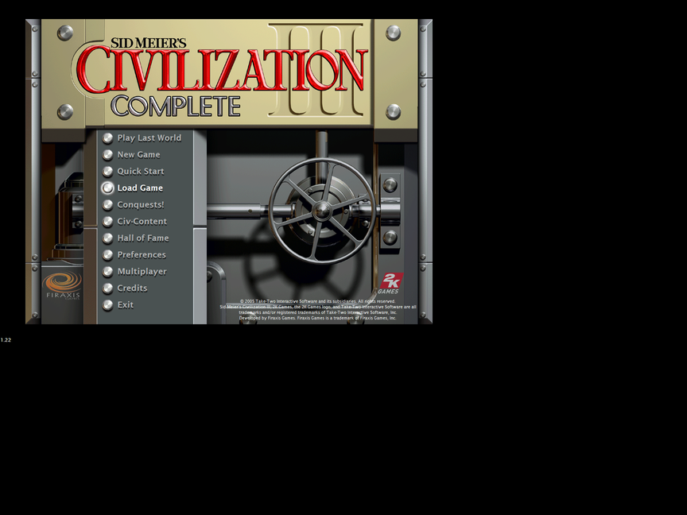
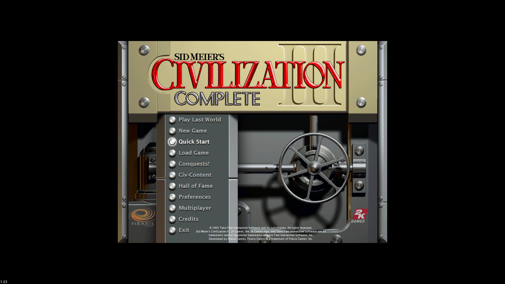
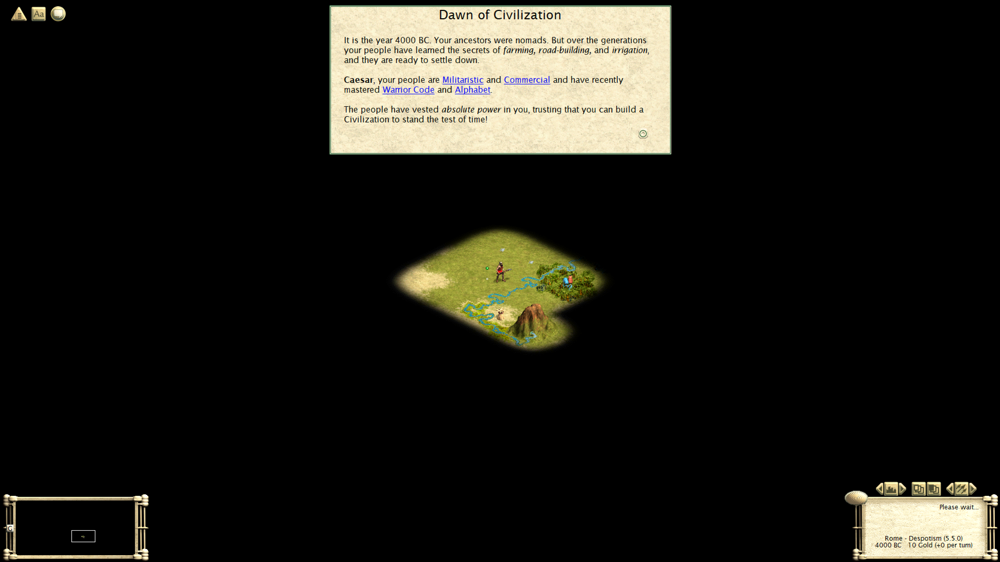

# Civ3 Borderless

Borderless fullscreen, resolution-independent UI and a properly locked cursor for
**Sid Meier's Civilization III: Complete** (Conquests, v1.22) on modern Windows.

The stock game runs at 1024×768, gets bitmap-stretched by Windows at 150 % DPI, and on a 4K
panel its interface is drawn at 1:1 physical pixels — hairline text and thumb-sized panels.
The usual community advice is "lower your desktop resolution before you play". This removes
the need for that.

No game file is modified. It is an app-local `opengl32.dll` proxy plus an ini, and it
uninstalls by deleting two files.

| Stock: 1152×864 window, 150 % DPI blur | Patched: borderless 4K, UI at 2× |
|---|---|
|  |  |



## Features

- **True borderless fullscreen** — a `WS_POPUP` window covering one monitor, no display-mode
  switch, no flicker, alt-tab leaves your desktop alone.
- **UI scales with resolution.** The engine is told the display is a smaller "virtual" size
  (1920×1080 by default) so it lays out its whole interface for that, and the finished frame is
  upscaled with a hard-edged integer scale. Map, panels, fonts and advisor screens all grow
  together. Exact 2× pixels at 4K, no blur.
- **Never stretched.** The engine always renders 16:9 — the aspect its UI was designed for —
  and the patch pillarboxes/letterboxes it on 21:9, 32:9, 16:10 and 4:3 panels.
- **DPI-aware.** Windows' 125/150/200 % bitmap stretch of the whole game is gone.
- **Locked cursor.** Confined to the game's monitor while the window has focus (so
  edge-scrolling works on multi-monitor setups), released the instant anything else is
  focused.
- **Cheap.** ~2 % of one core for the 1080p→4K upscale on a 2D game.

## Install

1. Close the game.
2. Grab `civ3bl-installer.zip` from [Releases](../../releases) and extract it anywhere.
3. Run `install.bat`, optionally with the Conquests folder as an argument:

   ```
   install.bat "E:\SteamLibrary\steamapps\common\Sid Meier's Civilization III Complete\Conquests"
   ```
   With no argument it installs into its own folder, so you can also just drop the files in
   `...\Sid Meier's Civilization III Complete\Conquests\` and run it there.

### What is in the zip, and what ends up in the game folder

The zip contains four files plus one DLL. `opengl32.dll` in the zip is **this project's own
build** — it is the patch, and shipping it is the whole point. It carries the name `opengl32.dll`
because Windows resolves an app-local DLL before the system one, and `opengl32` is not a
KnownDLL, which is what makes the game load it.

What the installer leaves in `...\Conquests\`:

| File | Where it comes from | What it is |
|---|---|---|
| `opengl32.dll` | the zip (built from this repo's `src/`) | the patch itself: proxy + the borderless/scaling logic |
| `opengl32_real.dll` | **copied by the installer from your own `C:\Windows\SysWOW64\opengl32.dll`** | the real OpenGL DLL the proxy forwards to. Never redistributed here — it is Microsoft's |
| `civ3bl.ini` | the zip (kept if you already have one) | configuration |
| `conquests.ini` | edited in place, original saved as `conquests.ini.bak` | `KeepRes=1`, `PlayIntro=0`, any `Video Mode=` removed |

So two DLLs land in the folder and they are a pair: `opengl32.dll` (ours) must be next to
`opengl32_real.dll` (yours) or the game will fail to start with `0xC0000139`.

Launch the game normally, from Steam or the exe.

**Uninstall:** run `uninstall.bat`, or delete both `opengl32.dll` and `opengl32_real.dll`.
If Steam ever "verifies integrity of game files" and removes the proxy, re-run `install.bat`.

Some antivirus products are twitchy about an unfamiliar DLL that shadows a system one, and
Windows may show a "downloaded file" prompt on the zip. That is the price of the technique, not
a sign of anything wrong; the full source is here and `toolsuild.bat` reproduces the binary.

## Configuration

`civ3bl.ini`, in the Conquests folder.

| Setting | Default | Meaning |
|---|---|---|
| `LogicalWidth` / `LogicalHeight` | `0` / `0` | Resolution the engine renders at — this *is* the UI scale. `0`/`0` = automatic 16:9 frame with the largest integer scale that fits. Pin both to force a size (e.g. `1280`/`720` for a 3× UI on 4K). |
| `Fit` | `integer` | `integer` = crisp whole-number scaling, bars if the aspect differs; `fit` = fractional fill; `stretch` = fill and ignore aspect (distorts). |
| `Monitor` | `0` | Monitor index. `0` = primary, `1` = second, … |
| `Borderless` | `1` | Restyle the window to a borderless popup covering the monitor. |
| `ScalePresent` | `1` | Scale the engine's frame up to the window. |
| `DpiAware` | `1` | Make the process per-monitor-v2 DPI aware before the engine creates its window. |
| `LockCursor` | `1` | Confine the cursor to the game's monitor while focused. |
| `LogLevel` | `0` | `0` silent, `1` write `civ3bl.log`, `2` verbose. |
| `LieScreen` / `LieClientRect` / `LieDeviceCaps` | `1` | Advanced: which APIs are lied to about the virtual display size. Leave all on — the engine derives buffer sizes and row strides from them and they must agree. |

Automatic sizing (16:9, integer scale):

| Monitor | Logical frame | Scale | Result |
|---|---|---|---|
| 1920×1080 | 1920×1080 | 1× | fills exactly |
| 2560×1440 | 1280×720 | 2× | fills exactly |
| 3840×2160 | 1920×1080 | 2× | fills exactly |
| 3440×1440 (21:9) | 1280×720 | 2× | 440 px pillar bars |
| 5120×1440 (32:9) | 1280×720 | 2× | 1280 px pillar bars |
| 2560×1600 (16:10) | 1280×720 | 2× | 80 px letterbox |
| 1024×768 (4:3) | 1024×576 | 1× | 96 px letterbox |

## How it works

Short version: Civ3 statically imports `OPENGL32`, so an app-local `opengl32.dll` is loaded
before any engine code, and it can make the process DPI-aware, present a "virtual display" to
the engine, and upscale the single GDI `BitBlt` the engine uses as its present.

The interesting part is that **every** size API has to agree, and the resize *messages* have to
be rewritten too, or the engine allocates a surface at one size and computes row strides from
another — which shows up as a write access violation deep inside its own palette loop, several
seconds after loading. Details, the API table and the crash triage recipe:
[docs/how-it-works.md](docs/how-it-works.md).

## Build from source

Requirements: Visual Studio 2019/2022 with the C++ tools (x86) and a Windows SDK.

```
git clone https://github.com/EffebGit/civ3-borderless-and-ui-fix.git
cd civ3-borderless-and-ui-fix
tools\build.bat          :: or: bash tools/build.sh   (Git Bash)
```

Output: `build\opengl32.dll`. The 32-bit compiler and the `.def` forwarder table are handled by
the script; `src\opengl32.def` / `src\opengl32_real.def` are checked in so the build needs no
Python. `tools\gen_proxy_def.py` regenerates them if you want to build against a different
Windows version's OpenGL export set.

## Limitations

- **Tested against the Steam 1.22 build** of `Civ3Conquests.exe`. The base game and PTW
  executables in the same install are untouched. It is a proxy DLL, so it is not tied to
  offsets in the exe and should survive most things except a new patch of the game.
- **The intro movie is disabled** (`PlayIntro=0`). Bink draws outside the engine's frame and
  cannot be scaled this way, so it would appear in a corner.
- **The title screen is a fixed 1024×768 bitmap**; the engine letterboxes it itself. Stock
  behaviour on any widescreen, not something this patch introduces.
- **Ultrawide:** you get a 16:9 image with bars (default), or pin a 21:9 logical size for a
  native wide map with the HUD anchored to the wide corners. The HUD cannot be pulled into a
  16:9 safe area while the map renders wide: the engine composites map and HUD into one
  surface in one pass, so the pixels underneath its panels never exist to move inward.
- **No HDR.** Presentation is GDI to a normal window, so output is SDR.
- No exclusive fullscreen. That is the point.

## License

[MIT](LICENSE). Use it, fork it, ship it in your own mod — just keep the copyright notice.

Not affiliated with Firaxis, Take-Two or 2K. No game assets are redistributed, and
`opengl32_real.dll` is not included — the installer copies your own system copy.
